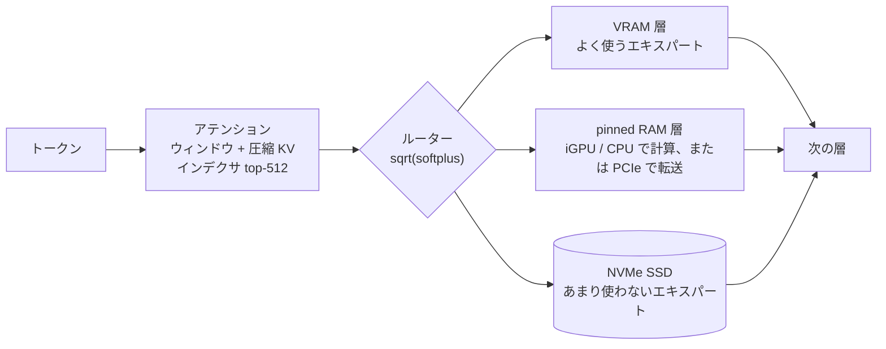
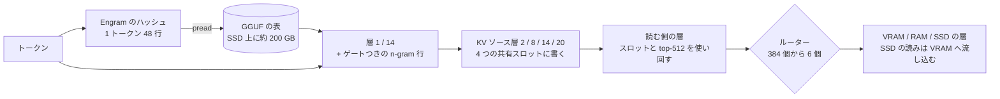

<div align="center">

# Abyss

**MoE モデルの DeepSeek V4 Flash（284B）と V4.1 Flash（1017）を、家庭用の GPU 1 枚で動かす。**

[](LICENSE)


-ED1C24?logo=amd&logoColor=white)


[](https://github.com/zephel01/Abyss/releases)

[English](README.md) · **日本語**

[クイックスタート](#-クイックスタート) · [性能](#-性能) · [しくみ](#-しくみ) ·
[マニュアル](docs/MANUAL.ja.md) · [更新履歴](CHANGELOG.md) · [クレジット](#-クレジット)

</div>

---

Abyss は [DeepSeek-V4-Flash](https://huggingface.co/deepseek-ai/DeepSeek-V4-Flash-0731) を GGUF から NVIDIA の GPU 1 枚で
動かす。よく使うエキスパートを VRAM に、次に使うものを pinned RAM に、残りを NVMe SSD に置き、会話に合わせて入れ替える。
ブラウザのチャットと、OpenAI / Anthropic 互換の API（思考とツール呼び出しに対応）が、すべて手元のマシンだけで動く。

**新しく対応: [DeepSeek V4.1 Flash（1017）](docs/deepseek41/README.md)**（v1.3.29〜1.3.32）— RTX 5090 + RAM 94 GB + NVMe と
nazeshinjite の Q2 GGUF で、生成は SSD だけの下位エキスパートを省く設定で約 28 tok/s（省かなければ 17.7）、swe-bench の
コーディング問題を通しで 51.6 tok/s。366 GB のうち約 200 GB は Engram の表で、SSD から行単位で読む。エキスパートも約 43% は
SSD に残る。V4 から変わった点は [V4.1 の仕様](docs/deepseek41/SPEC.md)。

**新しく対応: [DeepSeek の DSpark ドラフトモデル](docs/MANUAL.ja.md#dspark-のドラフトモデルdeepseek-v4-flash)**（v1.3.43、
任意: `./setup-deepseek.sh --dspark`）— 6.9 GB の下書きモデルが 1 回に最大 5 トークンを提案し、本体がまとめて 1 回で確かめる。
内蔵 GPU なしの AMD AI PRO R9700 で、swe-bench のコーディング問題が 48.4 → 61.9 tok/s（APU の内蔵 GPU をレーンに使うと 67.3）。

> [!NOTE]
> Abyss は [Project Maya](https://github.com/mw00/project-maya) をコピーして作ったフォークで、Maya は
> [Strata](https://github.com/Niko1221/Strata) から生まれたプロジェクト。Maya のエンジンに DeepSeek V4 と V4.1 への対応を足した。
> [クレジット](#-クレジット)を参照。

## ✨ 特長

- **284B の MoE を GPU 1 枚で** — 層ごとに 256 個あるエキスパートを VRAM・pinned RAM・SSD に分けて置く。どれを先に載せるかは使い方から学ぶ
- **DeepSeek V4.1 Flash にも対応** — 層ごとに 384 個のエキスパート、共有の圧縮 KV スロット、Engram の n-gram 表。表は GGUF から 1 トークン 48 行だけ読む。載りきらないエキスパートは SSD から読みながら VRAM に流し込む
- **生成は llama.cpp の約 3 倍、prompt の読み込みは約 5 倍**（同じ GGUF・同じマシン。llama.cpp は `-ncmoe` で調整した状態。エキスパートを CPU に置いた llama.cpp と比べると 10 倍以上）。prompt は約 1,600〜3,300 tok/s、生成は約 92〜95 tok/s
- **長いコンテキストでも落ちない** — lightning indexer と prompt の attention を tensor core で計算する。125K トークンの prompt を約 2,800 tok/s で読み、125K でも生成は約 65 tok/s
- **AMD APU の内蔵 GPU を 2 本目のレーンに** — Ryzen AI Max では Radeon の内蔵 GPU が RAM 層のエキスパートをその場で計算する。生成でも prompt でも使う（ROCm。起動時に CPU より速ければ使う）
- **ドラフトモデルなしの投機デコード** — prompt や応答に出てきた並び（n-gram）を候補にして、次のトークンと一緒に 1 回で確かめる。出力は同じで、コードで +10〜13%。既定でオン
- **DeepSeek の DSpark ドラフトモデル（任意）** — DeepSeek V4 の 3 層が本体の 40〜42 層の出力を読んで次の 5 トークンを下書きし、最大 6 トークンの検証の窓でまとめて確かめる。AI PRO R9700 の swe-bench で +28%（内蔵 GPU なしで 48.4 → 61.9 tok/s）。VRAM を約 6.5 GB 使う
- **実行時の無検閲化（任意）** — `--uncensor <file>` で、動かしながら残差への書き込みすべてから拒否の方向を取り除く。
  リクエストごとに入り切りでき、16〜82 KB のファイルは `--abl-build` で公開の質問セットから作れる。V4.1 / V4 /
  GLM-5.3-Flash: 有害な質問の拒否 85〜88% → 3〜8%、文章の KL 0.013〜0.053（[UNCENSOR](docs/UNCENSOR.ja.md)）。
- **llama.cpp と照合済み** — 3,000 トークンで次トークンの的中率が同じ（KL 0.009）
- **DeepSeek V4 / V4.1 のアテンションを全部実装** — スライディングウィンドウ、CSA/HCA 圧縮 KV（V4.1 は 4 つの共有スロットと 16K 超の候補ブロック）、インデクサの top-512、sinks
- **思考とツール呼び出し** — 思考レベル `none` / `low` / `high` / `max`、DeepSeek の DSML 形式のツール呼び出し（同時呼び出しも可）
- **OpenAI / Anthropic 互換 API** と、エキスパートの配置をリアルタイムで見られるブラウザのダッシュボード
- **複数 GPU、AMD、V100** — NVIDIA の複数カードに層を分けて載せる。Radeon 向けの HIP ビルド（試験的）、CUDA 12 での sm_70 ビルド
- **コマンド 1 つでセットアップ** — エンジン、モデル、pack、設定、運用スクリプトの `Abyss-tools` まで
- **EXL3 量子化（GLM-5.3-Flash、試験的）** — exllamav3 のトレリス量子化をそのまま読む。turboderp の sc_2.10bpw は
  Maya-S-v2 より 8 GB 小さく、文章の予測が良い（nll 1.59 対 1.63）。APU の lane では生成が約 8 割の速さ（v1.3.36）。
  どちらが合うかはインストーラが PC を見て示す（[EXL3](docs/exl3/README.md)）

## 📦 対応モデル

| モデル | GGUF / 量子化 | サイズ | 状態 |
| --- | --- | ---: | --- |
| DeepSeek V4 Flash 0731 | unsloth [UD-Q2_K_XL](https://huggingface.co/unsloth/DeepSeek-V4-Flash-0731-GGUF)（セットアップの既定） | 96.8 GB | 計測済み、swe-bench 60問中59問解決 |
| | huihui-ai の abliterated Q2、antirez の deepseek-v4-gguf（`--compat-bf16`） | 約 83 GB | 動作確認済み（llama.cpp との KL 0.0075） |
| | unsloth のほかの量子化で、expert の型が IQ1_S〜IQ4_XS、Q2_K〜Q6_K、MXFP4 のもの | | 動くはず、未確認 |
| | DeepSeek の DSpark ドラフトモデル（bleysg の [GGUF](https://huggingface.co/bleysg/DeepSeek-V4-Flash-DSpark-drafter-GGUF)、`--dspark`、v1.3.43） | 6.9 GB | AI PRO R9700 で計測済み（swe-bench +28%）。NVIDIA はビルドのみ、未計測 |
| DeepSeek V4.1 Flash 1017 | unsloth の [UD-IQ2_XXS](https://huggingface.co/unsloth/DeepSeek-V4.1-Flash-1017-GGUF)（v1.3.46 からのおすすめ） | 300 GB | 計測済み: nazeshinjite Q2 と同じ速さで KL 0.186（Q2 は 0.228） |
| | nazeshinjite の [Q2](https://huggingface.co/nazeshinjite/DeepSeek-V4.1-Flash-1017-ds4-GGUF) | 366 GB | 計測済み、swe-bench 最初の35問中34 |
| | unsloth の [UD-IQ1_S](https://huggingface.co/unsloth/DeepSeek-V4.1-Flash-1017-GGUF)（v1.3.38）、UD-IQ1_M | 233 / 266 GB | 計測済み: 速いが品質は下がる（KL 0.36 / 0.27） |
| | mrfakename の Q2_K、Lucebox の dense + Engram と mrfakename の expert の組み合わせ（ハイブリッド） | 247 / 201 GB | 動作確認済み: 単体では低品質 / 最も正確だが遅い |
| | unsloth のほかの量子化、Project Maya の Maya-S | 178〜508 GB | UD-IQ1_S と同じ形式、未確認 |
| | ISTA-DASLab の [GSQ-RCO](https://huggingface.co/ISTA-DASLab/DeepSeek-V4.1-Flash-1017-GSQ-RCO-GGUF) IQ2_XXS / IQ1_M（v1.3.53、Engram の表は別の GGUF） | 138 / 121 GB | AI PRO R9700 で計測済み: KL 0.31 / 0.38。サイズは Engram の表を除いた値。表を除くと UD-IQ1_M は 139.5 GB で KL 0.27 なので、同じサイズなら unsloth のほうが良い（v1.3.53 で「サイズあたりの品質が最も高い」と書いたのは、表を含むサイズと含まないサイズを比べた誤り） |
| | Lucebox の DSpark ドラフトモデル DeepSeek-V4.1-Flash-1017-DSpark-draft-Q2K-Q4K.gguf（`STRATA_DS4_DSPARK=<ファイル>`、v1.3.53） | 4.9 GB | AI PRO R9700 で計測済み: swe-bench +16%。約 3.4 GB/s の SSD では効果なし |
| | orcarouter の abliterated [Mix-256G](https://huggingface.co/orcarouter/DeepSeek-V4.1-Flash-1017-abliterated-GGUF)（制限解除版。Engram の shard は unsloth の UD-IQ1_S の shard 5 とバイト単位で同じ） | 236 GB + Engram | AI PRO R9700 で計測済み: KL 0.083（V4.1 で測った中で最良）、swe-bench 8 問で tail skip あり 22.4 tok/s（RAM 94 GB では SSD 待ちで頭打ち） |
| | mrfakename の abliteration の編集（`STRATA_GLM_ABL`、または `tools/dense_overlay.py --abl` のオーバーレイ） | 43 KB | 計測済み: 16 問中 12 問の拒否が 0 に、KL +0.002（[UNCENSOR](docs/UNCENSOR.ja.md)） |
| Ornith-1.5-122B（Qwen3.5-MoE、[docs/ornith](docs/ornith/README.md)） | unsloth の [UD-Q4_K_XL](https://huggingface.co/unsloth/Ornith-1.5-122B-GGUF)（v1.3.46） | 79.7 GB | AI PRO R9700 で計測済み: 42 tok/s、llama.cpp との KL 0.024。NVIDIA はビルドのみ、未計測 |
| | 自作の [IQ3_XXS-B](https://huggingface.co/zephel01/Ornith-1.5-122B-IQ3_XXS-16G64G-GGUF)（GPU 16 GB + RAM 64 GB 向け） | 51.7 GB | 計測済み（VRAM を 16 GB に制限、iGPU レーンなし）: NextN ドラフトありで 42.6 tok/s、swe-bench 60 問中 56 問解決（UD-Q4_K_XL は 54） |
| | unsloth の [UD-IQ3_XXS](https://huggingface.co/unsloth/Ornith-1.5-122B-GGUF) | 49.5 GB | 同じ条件で計測済み: IQ3_XXS-B と同じ品質（KL 0.140 / 0.138）で約 3% 速い |
| Qwen3.5-122B-A10B（Qwen3.5-MoE、Ornith と同じ形式） | 自作の [IQ3_XXS-B2](https://huggingface.co/zephel01/Qwen3.5-122B-A10B-IQ3_XXS-16G64G-GGUF)（GPU 16 GB + RAM 64 GB 向け） | 51 GB | 計測済み: KL 0.035、41.2 tok/s、swe-bench 60 問中 53 問解決 |
| Qwen3.8-Flash-Next（qwen4exp、[docs/qwen38](docs/qwen38/README.ja.md)） | orcarouter の [Uncensored IQ3_XXS](https://huggingface.co/orcarouter/Qwen3.8-Flash-Next-Uncensored-GGUF) を速い経路で（v1.3.74） | 85.2 GB | AI PRO R9700 で計測: プロンプト 30K で 1,037 tok/s、答えは MTP ドラフターありで文章 64〜65 tok/s / コード 86、llama.cpp 比 KL 0.026。NVIDIA は未ビルド |
| GLM-5.3-Flash（Maya のもの） | Maya-S-v2 IQ2_XXS、Maya-S24 | 96.5 / 94.7 GB | 計測済み |
| | turboderp の EXL3 sc_2.10bpw（[EXL3](docs/exl3/README.md)） | | 計測済み、試験的 |
| | kindlingai の [exlr8](https://huggingface.co/kindlingai/glm-5.3-flash-exlr8-k2-k3-k4) K2 を `tools/exlr8_convert.py` で変換（v1.3.53） | 86 GB | AI PRO R9700 で計測済み: 約 23 tok/s、nll 1.61（Maya-S-v2 は 1.634、低いほど良い）。K3（125 GB）は nll 1.548、約 11 tok/s |

V4.1 でどのファイルを選ぶかと、それぞれの測り方: [docs/deepseek41/README.md](docs/deepseek41/README.md#ggufs-that-load)。
測ったファイルすべての品質と速さ、GPU ごとの参考値（こちらの実測と、利用者の報告）: [docs/MODELS.ja.md](docs/MODELS.ja.md)。
自分の PC を同じ方法で測り、どこで時間がかかっているかを見るには `./abyss.sh --bench --deep` を実行してください（[docs/BENCH.ja.md](docs/BENCH.ja.md)）。

## 📊 性能

unsloth の [DeepSeek-V4-Flash-0731-GGUF](https://huggingface.co/unsloth/DeepSeek-V4-Flash-0731-GGUF) `UD-Q2_K_XL`
（96.8 GB）、RTX 5090（32 GB、PCIe Gen4 x4）+ Ryzen AI Max+ 395（RAM 94 GB、iGPU レーンあり）、Linux。生成の行は
Abyss v1.3.21〜1.3.27、prompt と 125K の行は v1.3.16〜1.3.18。llama.cpp（`bed0a8566`）は同じマシン・同じファイルで、
いちばん速い設定（`-ngl 99 -ncmoe 32`）:

| | Abyss | llama.cpp |
| --- | :---: | :---: |
| 生成（1,024 トークンの応答、文章 / コード） | **約 92〜95 tok/s** | 28〜30 tok/s |
| 生成（swe-bench のコーディング問題 16 問 × 3、通し） | **約 100 tok/s** | – |
| 生成（swe-bench のコーディング問題 60 問 × 5、通し） | **約 107 tok/s**（1 問 100.5〜114.5、60 問中 59 問解決） | – |
| 生成（コンテキスト 125K トークン） | **約 65 tok/s** | – |
| prompt（8K トークン） | **約 1,630〜1,760 tok/s** | 78（ubatch 512）〜 660（ubatch 8192） |
| prompt（32K トークン） | **約 3,100〜3,270 tok/s** | – |
| prompt（125K トークン） | **約 2,800 tok/s** | – |
| 起動（重み + エキスパートの読み込み） | 約 1 分 | 約 50 秒 |

エキスパート 11,008 個がすべて VRAM（23 GB）+ pinned RAM（70 GB）に収まる。読み込み後は SSD を読まない。生成の数値は
attention の射影を Q5_K にした「軽い dense pack」（マニュアル参照。配布 GGUF のままより +8%、swe-bench の品質は同じ）での実測。
内蔵 GPU がなく CPU レーンで計算する環境（RAM が足りる NVIDIA の PC）では、生成は約 55〜60 tok/s。
数値はすべて測り方とともに[更新履歴](CHANGELOG.md)にある。

<details>
<summary><b>ほかに測った構成</b></summary>

| 構成 | 生成 | prompt 8K / 32K |
| --- | :---: | :---: |
| RTX 3090（USB4 ケース、約 3.8 GB/s）+ iGPU レーン | 約 49 tok/s | 約 690 / 約 1,010 tok/s |
| RTX 5090 + RTX 3090（層を 33 / 10 に分割、`STRATA_GLM_SPLIT_KEEP=1`）+ iGPU レーン | 約 87〜90 tok/s | 約 1,420〜1,510 / 約 2,270〜2,350 tok/s |
| Radeon 8060S 単体（HIP ビルド。エキスパートの一部は SSD から） | – | 7K の prompt 約 150 tok/s |

遅い 2 枚目を足しても、RTX 5090 1 枚 + iGPU レーンには届かない。生成は 2 枚を順番に通るので、3090 の層（5090 の 1.64 倍
遅い）の時間が、増えた VRAM で減る RAM 層の待ちを上回る。v1.3.25 からは `--layer-split auto` がこれを測り、
`STRATA_GLM_SPLIT_KEEP=1` がなければ 5090 だけで動く（94〜95 tok/s）。投機デコードと prestage は v1.3.26 / v1.3.27 から
分割時も使える。

</details>

<details>
<summary><b>AMD AI PRO R9700 と DSpark ドラフトモデル（v1.3.43）</b></summary>

AI PRO R9700（32 GB、OCuLink PCIe Gen4 x4）を同じ Ryzen AI Max+ 395 の PC（RAM 94 GB）につないだ構成。UD-Q2_K_XL と Q5_K の
attention pack、サーバー経由:

| | ドラフトモデルなし | DSpark |
| --- | :---: | :---: |
| swe-bench のコーディング 6 問（サンプリングあり、通し）、内蔵 GPU なし | 48.4 tok/s（v1.3.42） | **61.9 tok/s** |
| 同じく内蔵 GPU レーンあり | 51.7 tok/s（v1.3.41） | **67.3 tok/s** |
| 1,024 トークンの回答、コード / 散文（貪欲、内蔵 GPU なし） | 46.6〜48.6 / 47.2〜47.5 tok/s | **63.4〜66.4 / 50.5〜51.4 tok/s** |
| prompt 8K / 16K | 850 / 978〜1,028 tok/s | 799 / 977〜1,000 tok/s |

下書きモデルは 1 トークンごとに次の最大 5 トークンを提案する。これらの問題では 68〜82% が受理され、1 回の確認で
2.7〜3.7 トークン進む（コードを写す問題では 4.7）。下書きモデルが使う VRAM 6.5 GB の分だけ、いちばん使われない約 6.5 GB の
エキスパートが SSD に回る（読み込みは 1 トークンあたり 0.01 回）。検証の窓は 1 列増えるごとに、CPU レーンが 1 トークン分の
RAM 層エキスパートを計算する時間とほぼ同じだけ延びる。そのため、速い GPU より速い CPU / RAM や内蔵 GPU レーンのほうが効く。
ドラフトモデルなしの回答と prompt は同じ v1.3.43 のビルド。NVIDIA ではまだ測っていない。詳しくは
[マニュアル](docs/MANUAL.ja.md#dspark-のドラフトモデルdeepseek-v4-flash)。

</details>

<details>
<summary><b>DeepSeek V4.1 Flash（1017）</b></summary>

同じマシン、nazeshinjite の [Q2 GGUF](https://huggingface.co/nazeshinjite/DeepSeek-V4.1-Flash-1017-ds4-GGUF)（366 GB）、
RAM 層 60 GB、モデルは NVMe（3.4 GB/s）、Abyss v1.3.31:

| | 生成 | 品質（量子化前の 1017 に対する KL、top-1 一致） |
| --- | :---: | :---: |
| SSD だけの 4〜6 位を省く（`STRATA_GLM_TAIL_SKIP=3` + `_DISK=1`） | 約 28 tok/s（1 トークン 35.9 ms、held-out の 8 本） | 0.241、78.9% |
| ルーティングどおり | 17.7 tok/s | 0.229、79.2% |
| swe-bench、60 問 × 5 のうち最初の 35 問（省く設定） | 通しで 51.6 tok/s、35 問中 34 問解決 | （DeepSeek V4 Flash: 107.2 tok/s、35 問） |

速さは 1 トークンに SSD から読むエキスパートの数で決まる。ほとんど読まない回答は 65〜75 tok/s。60 問の実行は、v1.3.32 で
直した 16K のバグで 35 問目に止まったので、測り直している。詳しくは
[docs/deepseek41/README.md](docs/deepseek41/README.md)。

</details>

## 🚀 クイックスタート

```sh
git clone https://github.com/zephel01/Abyss.git ~/llm/apps/Abyss
cd ~/llm/apps/Abyss
./setup-deepseek.sh --download-model     # エンジン、モデル（96.8 GB）、pack、設定、../Abyss-tools
../Abyss-tools/abyss.sh start            # → http://127.0.0.1:8082/
```

DeepSeek の DSpark ドラフトモデルで回答を速くするには（6.9 GB 追加、VRAM 約 6.5 GB、GPU 1 枚のとき）:
`./setup-deepseek.sh --dspark` のあと `../Abyss-tools/abyss.sh restart`。

API で試す:

```sh
curl http://127.0.0.1:8082/v1/chat/completions -H 'Content-Type: application/json' \
  -d '{"messages":[{"role":"user","content":"日本の首都はどこですか？"}],"max_tokens":4000}'
```

<details>
<summary><b>セットアップがやること</b></summary>

1. PC の確認（NVIDIA GPU、RAM）
2. Python パッケージを `.venv` に入れ、固定コミットの llama.cpp のソースを取る
3. GPU に合わせてエンジンをビルド（RTX 50 は `120a`）
4. モデルを `../Abyss-data` にダウンロード（`--download-model` がなければ先に確認）し、全ファイルの SHA-256 を照合
5. シャードと同じフォルダに pack を作る
6. `abyss-<名前>.json` と `run-abyss-<名前>.sh` を書く
7. DSpark ドラフトモデル: 設定が新しいときに確認する（`--dspark` なら確認なし）。ダウンロードして SHA-256 を照合し、設定に書く
8. `../Abyss-tools` を作る — `abyss.sh start | stop | restart | status | update | build | log | models`

済んだ手順は飛ばすので、何度実行してもよい。オプション（`--quant`、`--context`、`--port`、`--gpus 0,1`（層の分割）、
`--backend hip`（AMD）、`--nvcc`（V100 用の CUDA 12）、`--dspark` / `--no-dspark`、`--tools-only` など）は
[マニュアル](docs/MANUAL.ja.md#まとめてセットアップ)。

</details>

### 必要なもの

| | |
| --- | --- |
| OS | Linux（Ubuntu で確認） |
| GPU | NVIDIA: RTX 5090 32 GB と RTX 3090 で測定。V100 は CUDA 12 でビルドできる（実機は未確認）。AMD Radeon は HIP で試験的に対応: Radeon 8060S と AI PRO R9700（8060S をレーンに）で動作。[docs/amd](docs/amd/README.ja.md) |
| メモリ | 全エキスパートをメモリに置くには VRAM + RAM が約 100 GB 以上（少なくても SSD から読んで動く） |
| ディスク | 空き約 100 GB の NVMe SSD（DeepSeek V4.1 は約 370 GB。速いほどよい） |
| ツール | CUDA 13.x（`nvcc`。V100 は 12.9）、g++、Python 3.10 以上。AMD APU の iGPU レーンと AMD ビルドには、Linux は ROCm 10、Windows は AMD の ROCm SDK 7.14（`hipcc`。HIP 7.14 以降。ROCm 7.0〜7.2 はいまのドライバと組み合わせると失敗する: [docs/amd](docs/amd/README.ja.md)） |

## 🧠 しくみ



各層のアテンションは GPU で計算し、ルーターが 256 個から 6 個のエキスパートを選ぶ。VRAM にあるものはそのまま計算する。
RAM 層のものはその場で計算する（APU の内蔵 GPU があればそれが、なければ CPU のスレッドが）か、PCIe で GPU に送る
（配分は起動時に測って決める）。残りは SSD から読み、使われるほど上の層に上がる。長い prompt はエキスパートの行列積
（MMQ）と tensor core の attention を使うまとめ処理で読む。応答が文中の並びを繰り返すときは、n-gram の候補を次の
トークンと一緒に確かめる。DeepSeek の DSpark ドラフトモデル（任意）を使うと、DeepSeek V4 の 3 層が本体の 40〜42 層の
出力を読んで次の 5 トークンを下書きし、同じように確かめる。
詳しくは [docs/deepseek4/PORT.md](docs/deepseek4/PORT.md)、計算の仕様は [docs/deepseek4/SPEC.md](docs/deepseek4/SPEC.md)。

### DeepSeek V4.1 で変わるところ

V4.1 Flash も同じ経路で動く。新しい部分と違う部分は次のとおり（[V4.1 の仕様](docs/deepseek41/SPEC.md)）:

| | V4 Flash | V4.1 Flash（1017） |
| --- | --- | --- |
| 形 | 43 層、隠れ 4096、エキスパート 256 | 40 層、隠れ 5120、エキスパート 384（6 個を選ぶ） |
| 圧縮 KV | 圧縮する層がそれぞれ自分で圧縮（比率 4 か 128） | 層 2 / 8 / 14 / 20 が 4 つの共有スロットに書き（比率 2 か 1）、ほかの層はそれを読む |
| インデクサ | 比率 4 の層すべて、64 ヘッド | 8 つのインデックス層、32 ヘッド。間の層はその top-512 を使い回す。16K 超は候補ブロックで絞る |
| hyper-connection | 同じ副層の `pre`、ゲートつきの head | 1 つ前の副層の `pre`、head のテンソルなし |
| ルーター | 層 0〜2 はトークン ID で決める | すべての層でバイアスつき top-6 |
| Engram | - | 2〜4-gram をハッシュした行（表 2 本、各約 101 GB）を層 1 と 14 の前に足す |



## ✅ 正しさの確認

同じ GGUF で、llama.cpp の logits と比べた（`tools/dsv4_logits_dump.cpp`）:

| テスト | 結果 |
| --- | --- |
| 3,000 トークンの文書 | KL 0.009 · top-1 一致 94.5% · 次トークン的中率 60.35%（llama.cpp も 60.35%）· 位置が進んでもずれは増えない |
| まとめ処理で 2,499 トークン → 500 トークン | KL 0.006 · top-1 一致 95.2% |
| トークナイザー（`joyai-llm`） | `llama-tokenize` と同じ ID |
| DeepSeek V4.1 Flash（1017）、llama.cpp の V4.1 PR と同じ GGUF、1,023 位置 | 量子化前の 1017 に対する KL 0.639（llama.cpp: 0.636）· nll 2.653（2.661） |

速度の変更はすべて同じ方法で確かめ直している（リリースごとの KL は[更新履歴](CHANGELOG.md)）。tensor core のカーネルは
FP32 のものと 2e-6 程度で一致し、投機デコードは 1 トークンずつの処理と同じ logits を返す。

## 📚 ドキュメント

| | |
| --- | --- |
| [マニュアル](docs/MANUAL.ja.md) · [Manual](docs/MANUAL.md) | セットアップ、設定、API、複数 GPU、AMD、設定項目、トラブル対応 |
| [設定ファイル](docs/SETTINGS.ja.md) · [Config files](docs/SETTINGS.md) | 設定ファイルと起動スクリプトの場所、変えたいこと別の書き換え場所、全項目、書き換えたあとの反映 |
| [無検閲化](docs/UNCENSOR.ja.md) · [Uncensoring](docs/UNCENSOR.md) | `--uncensor` の有効化、自分のモデル用のファイル作り、実測、以前からある方法 |
| [AMD Radeon](docs/amd/README.ja.md) · [English](docs/amd/README.md) | AMD: ドライバ、ROCm（アーキテクチャ別のパッケージ）、単体の Radeon と APU の iGPU、トラブル対応 |
| [更新履歴](CHANGELOG.md) | 各リリースの内容と測定結果 |
| [移植の記録](docs/deepseek4/PORT.md) | Abyss が足したものと、その確認方法 |
| [仕様](docs/deepseek4/SPEC.md) | 実装した DeepSeek V4 の計算 |
| [DeepSeek V4.1](docs/deepseek41/README.md) | V4.1 Flash（1017）: 読める GGUF、pack、動かし方、品質と速さ、設定（英語） |
| [V4.1 の仕様](docs/deepseek41/SPEC.md) | V4 の計算から V4.1 で変わる点と、Abyss での実装箇所（英語） |
| [EXL3](docs/exl3/README.md) | GLM-5.3-Flash の exllamav3 量子化: 向いている PC、選べる量子化、pack、測定結果、設定（英語） |
| [Maya のドキュメント](docs/maya/README.md) | Maya の文書をそのまま残したもの: GLM-5.3-Flash、インストーラ（`./abyss.sh`）、チューニング、AMD、複数 GPU |

## 🗺️ ロードマップ

- [x] DeepSeek V4 Flash: 1 トークンずつの処理、まとめ処理、会話の再利用
- [x] DeepSeek V4.1 Flash（1017）: 1 トークンずつの処理、まとめ処理、会話の再利用、SSD から読む Engram
- [x] DeepSeek V4.1 の 16K 超（候補ブロック、v1.3.32）、SSD の読みを VRAM へ流し込む転送（v1.3.31）
- [x] 思考レベル、DSML のツール呼び出し、OpenAI / Anthropic 互換 API
- [x] コマンド 1 つのセットアップと `Abyss-tools`
- [x] iGPU レーン（Ryzen AI Max）。生成と prompt の両方
- [x] 文章自体から候補を作る投機デコード（n-gram）。既定でオン
- [x] 長いコンテキスト: indexer と prompt の attention を tensor core で（125K まで確認）
- [x] NVIDIA の複数 GPU（層の分割。投機デコードと prestage も。RTX 5090 + RTX 3090 で測定）
- [x] AMD（HIP、試験的）: Radeon 8060S で WMMA カーネルを使って動作
- [x] V100（sm_70）を CUDA 12 でビルド
- [x] GLM-5.3-Flash の EXL3 量子化（exllamav3）: GPU、iGPU lane、CPU lane で計算。インストーラが PC ごとにおすすめを表示
- [ ] DeepSeek V4 / V4.1 の EXL3 量子化、RDNA 向けに調整した iGPU のトレリス計算
- [x] DeepSeek V4 Flash 0731 用の DSpark ドラフトモデル（v1.3.43、任意。AI PRO R9700 で計測、NVIDIA は未計測）
- [ ] 会話のディスク保存
- [ ] DeepSeek V4 での Windows（確認したのは Linux。RX 7900 XT でのコミュニティビルドは [AMD HIP](docs/maya/AMD_HIP.md)）
- [ ] DeepSeek V4.1: 投機デコード（MTP / DSpark のドラフト）、prompt の attention のまとめ処理、層の分割、コマンド 1 つのセットアップ、SSD の読みを減らす（追い出し方の見直し、SSD から届いたエキスパートを lane で計算）
- [ ] 複数カードでの速度: 分割時の prompt（ここでは RTX 5090 1 枚より 30% 遅い）、V100 の実機、単体の Radeon
- [ ] 短い prompt のまとめ処理の調整（8K では RAM 層のエキスパートを GPU に送る時間が大半）

## 🙏 クレジット

Abyss は **[Project Maya](https://github.com/mw00/project-maya)**（MIT、mw00 とコントリビューター）をコピーして作った
フォークで、Maya は **[Strata](https://github.com/Niko1221/Strata)**（MIT、Niko1221 と Strata のコントリビューター）から
生まれた。Maya の GLM-5.3-Flash の実行部、エキスパートの配置、まとめ処理、サーバー、ダッシュボードはそのまま使い、そこに
DeepSeek V4（llama.cpp の `deepseek4` アーキテクチャ）と V4.1（`deepseek41`）を GLM-5.3-Flash と並べて足した。Maya の README と文書は
[docs/maya/](docs/maya/README.md) に残している。DeepSeek V4 の計算は [llama.cpp](https://github.com/ggml-org/llama.cpp) の
実装に、量子化モデルは [unsloth](https://huggingface.co/unsloth) のものに拠っている。V4.1 の移植は antirez の DwarfStar（ds4）と
llama.cpp の V4.1 プルリクエストに拠り、GGUF は nazeshinjite と mrfakename のもの、品質の基準は Lucebox の held-out セット。
DSpark のドラフトモデルは DeepSeek のもの（V4 Flash の公式ドラフトモデル）で、[Entrpi/ds4](https://github.com/Entrpi/ds4) の
`gguf-tools` で取り出したものを bleysg が GGUF で公開している（MIT）。計算は antirez の ds4 と llama.cpp の dflash に拠る。
EXL3 対応は Maya（@needmorevram）のもので、[exllamav3](https://github.com/turboderp-org/exllamav3) の形式・コードブック・
カーネルに拠る（MIT、Copyright (c) 2025 Turboderp。[third_party/exllamav3/LICENSE](third_party/exllamav3/LICENSE)）。EXL3 の
量子化モデルは turboderp のもの。すべてに感謝する。

## 📄 ライセンス

Maya・Strata と同じく MIT — [LICENSE](LICENSE)。モデルの重みはそれぞれのライセンスに従う（DeepSeek V4: MIT。V4.1 はモデルカードを確認）。
