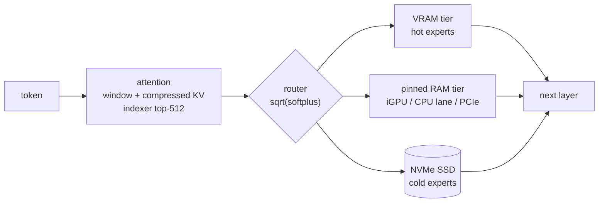
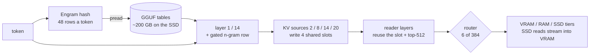

<div align="center">

# Abyss

**Run DeepSeek V4 Flash (284B) and V4.1 Flash (1017) — mixture-of-experts models — on a single consumer GPU.**

[](LICENSE)


-ED1C24?logo=amd&logoColor=white)


[](https://github.com/zephel01/Abyss/releases)

**English** · [日本語](README.ja.md)

[Quick start](#-quick-start) · [Performance](#-performance) · [How it works](#-how-it-works) ·
[Manual](docs/MANUAL.md) · [Changelog](CHANGELOG.md) · [Credits](#-credits)

</div>

---

Abyss runs [DeepSeek-V4-Flash](https://huggingface.co/deepseek-ai/DeepSeek-V4-Flash-0731) from a GGUF on one NVIDIA
GPU. The engine keeps the most-used experts in VRAM, the next ones in pinned RAM and the rest on the NVMe SSD, and
moves them as the conversation needs them. You get a browser chat and OpenAI- / Anthropic-compatible APIs, with
thinking and tool calls — all on your own machine.

**New: [DeepSeek V4.1 Flash (1017)](docs/deepseek41/README.md)** (v1.3.29-1.3.32) — on an RTX 5090 + 94 GB RAM + NVMe
with nazeshinjite's Q2 GGUF: ~28 tok/s decode with the disk tail skip (17.7 with exact routing), 51.6 tok/s end to end
on swe-bench coding tasks. Its 366 GB include ~200 GB of Engram tables, read row by row from the SSD, and ~43% of its
experts stay on the SSD. What changed from V4: [the V4.1 spec](docs/deepseek41/SPEC.md).

**New: [DeepSeek's DSpark drafter](docs/MANUAL.md#the-dspark-drafter-deepseek-v4-flash)** (v1.3.43, opt-in:
`./setup-deepseek.sh --dspark`) — a 6.9 GB block drafter proposes up to 5 tokens a step and the model checks them in
one pass. On an AMD AI PRO R9700 without an iGPU, swe-bench coding tasks run at 61.9 tok/s instead of 48.4 (67.3 with
the APU's iGPU as a lane).

> [!NOTE]
> Abyss is a fork of [Project Maya](https://github.com/mw00/project-maya), which grew out of
> [Strata](https://github.com/Niko1221/Strata). It adds DeepSeek V4 and V4.1 to Maya's engine. See [Credits](#-credits).

## ✨ Highlights

- **284B MoE on one card** — 256 experts per layer spread over VRAM, pinned RAM and SSD, filled from your own usage.
- **DeepSeek V4.1 Flash too** — 384 experts a layer, shared compressed-KV slots and the Engram n-gram tables, read
  48 rows a token straight from the GGUF; the experts that do not fit stream from the SSD into VRAM as they are read.
- **~3x llama.cpp's decode speed and ~5x its prompt speed** on the same GGUF and machine (llama.cpp tuned with
  `-ncmoe`; 10x+ against its experts on the CPU). Prompts at ~1,600–3,300 tok/s, decode at ~92–95 tok/s.
- **Long contexts stay fast** — the lightning indexer and the prompt attention run on tensor cores: a 125K-token
  prompt reads at ~2,800 tok/s, and decode holds ~65 tok/s at 125K.
- **An AMD APU's integrated GPU as a second lane** — on a Ryzen AI Max the Radeon iGPU computes the RAM-tier experts
  in place, for decode and for prompts (ROCm; picked at start when it is faster than the CPU).
- **Speculative decoding without a draft model** — n-gram drafts from the prompt and the answer, verified in one pass;
  the same output, +10–13% on code. On by default.
- **DeepSeek's DSpark drafter (opt-in)** — three DeepSeek V4 layers read the model's own layer 40–42 outputs and draft
  5 tokens a step, verified in windows of up to 6 tokens: +28% on swe-bench tasks on an AI PRO R9700 (48.4 → 61.9
  tok/s without an iGPU). It takes ~6.5 GB of VRAM.
- **Two SSDs without a RAID (opt-in)** — copy the model's shards to a second NVMe and `STRATA_GLM_MIRROR=<folder>`
  reads every expert from whichever drive will finish first: SSD waits −20%, and on 32 GB VRAM + 64 GB RAM DeepSeek
  V4.1 UD-IQ2_XXS decodes 21% faster even with the second drive on USB4 at half the speed ([SSD2](docs/SSD2.md)).
- **Uncensoring at run time (opt-in)** — `--uncensor <file>` takes the refusal direction out of every residual write
  while it runs, switchable per request; `--abl-build` makes the 16-82 KB file from public prompt sets. V4.1 / V4 /
  GLM-5.3-Flash: harmful prompts refused 85-88% → 3-8%, text KL 0.013-0.053 ([UNCENSOR](docs/UNCENSOR.md)).
- **Checked against llama.cpp** — same next-token accuracy over 3,000 tokens (KL 0.009).
- **Full DeepSeek V4 / V4.1 attention** — sliding window, CSA/HCA compressed KV (V4.1: four shared slots and candidate
  blocks past 16K), the lightning indexer's top-512, sinks.
- **Thinking and tool calls** — reasoning levels `none` / `low` / `high` / `max`, DeepSeek's DSML tool calls, parallel calls.
- **OpenAI and Anthropic APIs** plus a browser dashboard with a live view of the expert tiers.
- **Several GPUs, AMD, V100** — a layer split across NVIDIA cards, an experimental HIP build for Radeon, and an sm_70
  build with CUDA 12.
- **One-command setup** — engine, model, pack, config and the `Abyss-tools` helper scripts.
- **EXL3 quants (GLM-5.3-Flash, experimental)** — exllamav3's trellis quants read in place: turboderp's sc_2.10bpw
  predicts text better than Maya-S-v2 at 8 GB less (nll 1.59 vs 1.63), decoding at ~80% of its speed on an APU lane (v1.3.36); the
  installer says which suits your PC ([EXL3](docs/exl3/README.md)).

## 📦 Supported models

| Model | GGUF / quant | Size | Status |
| --- | --- | ---: | --- |
| DeepSeek V4 Flash 0731 | unsloth [UD-Q2_K_XL](https://huggingface.co/unsloth/DeepSeek-V4-Flash-0731-GGUF) (the setup's default) | 96.8 GB | measured, swe-bench 59 of 60 resolved |
| | huihui-ai's abliterated Q2, antirez's deepseek-v4-gguf (`--compat-bf16`) | ~83 GB | runs (KL 0.0075 against llama.cpp) |
| | unsloth's other quants with these expert types: IQ1_S-IQ4_XS, Q2_K-Q6_K, MXFP4 | | should run, untested |
| | DeepSeek's DSpark drafter for it, bleysg's [GGUF](https://huggingface.co/bleysg/DeepSeek-V4-Flash-DSpark-drafter-GGUF) (`--dspark`, v1.3.43) | 6.9 GB | measured on an AI PRO R9700 (swe-bench +28%); NVIDIA: builds, not measured |
| DeepSeek V4.1 Flash 1017 | unsloth [UD-IQ2_XXS](https://huggingface.co/unsloth/DeepSeek-V4.1-Flash-1017-GGUF), re-uploaded 2026-10-28 (the pick for quality) | 300 GB | measured on an AI PRO R9700: KL 0.141 (old file 0.188), swe-bench 8 tasks 33.9 tok/s on 32 GB + 96 GB, 29.5 on 32 GB + 64 GB ([which file](docs/deepseek41/README.md#ggufs-that-load)) |
| | unsloth [UD-IQ1_M](https://huggingface.co/unsloth/DeepSeek-V4.1-Flash-1017-GGUF), re-uploaded 2026-10-28 (the pick for speed) | 250 GB | measured the same way: KL 0.199 (old 0.270), **40.6 tok/s** on 32 GB + 96 GB, 30.5 on 32 GB + 64 GB |
| | nazeshinjite [Q2](https://huggingface.co/nazeshinjite/DeepSeek-V4.1-Flash-1017-ds4-GGUF) | 366 GB | measured, swe-bench 34 of the first 35 |
| | unsloth [UD-IQ1_S](https://huggingface.co/unsloth/DeepSeek-V4.1-Flash-1017-GGUF) (re-uploaded 2026-10-28) | 233 GB | measured: runs, not recommended (KL 0.257; old file 0.36) |
| | mrfakename Q2_K; Lucebox dense + Engram with mrfakename's experts (a hybrid) | 247 / 201 GB | runs: low quality alone / the most accurate, slow |
| | unsloth's other quants, Project Maya's Maya-S | 178-508 GB | same layout as UD-IQ1_S, untested |
| | ISTA-DASLab [GSQ-RCO](https://huggingface.co/ISTA-DASLab/DeepSeek-V4.1-Flash-1017-GSQ-RCO-GGUF) IQ2_XXS / IQ1_M (v1.3.53, the Engram table as a separate GGUF) | 138 / 121 GB | measured on an AI PRO R9700: KL 0.31 / 0.38. The sizes leave out the Engram table: without it UD-IQ1_M is 139.5 GB at KL 0.27, so at the same size unsloth's is better (v1.3.53 called IQ2_XXS the best per GB, comparing sizes with and without the table - wrong) |
| | the Lucebox DSpark drafter, DeepSeek-V4.1-Flash-1017-DSpark-draft-Q2K-Q4K.gguf (`STRATA_DS4_DSPARK=<file>`, v1.3.53) | 4.9 GB | measured on an AI PRO R9700: swe-bench +16%, no gain on a ~3.4 GB/s SSD |
| | orcarouter's abliterated [Mix-256G](https://huggingface.co/orcarouter/DeepSeek-V4.1-Flash-1017-abliterated-GGUF) (uncensored; its Engram shard is byte for byte unsloth's UD-IQ1_S shard 5) | 236 GB + Engram | measured on an AI PRO R9700: KL 0.083 (the best V4.1 measured), swe-bench 8 tasks 22.4 tok/s with the tail skip (SSD-bound on 94 GB of RAM) |
| | mrfakename's abliteration edit (`STRATA_GLM_ABL`, or an overlay with `tools/dense_overlay.py --abl`) | 43 KB | measured: refusals 12 of 16 -> 0, KL +0.002 ([UNCENSOR](docs/UNCENSOR.md)) |
| Ornith-1.5-122B (Qwen3.5-MoE, [docs/ornith](docs/ornith/README.md)) | unsloth [UD-Q4_K_XL](https://huggingface.co/unsloth/Ornith-1.5-122B-GGUF) (v1.3.46) | 79.7 GB | measured on an AI PRO R9700: 42 tok/s, KL 0.024 against llama.cpp; NVIDIA: builds, not measured |
| | our [IQ3_XXS-B](https://huggingface.co/zephel01/Ornith-1.5-122B-IQ3_XXS-16G64G-GGUF) for a 16 GB GPU + 64 GB RAM | 51.7 GB | measured (VRAM capped at 16 GB, no iGPU lane): 42.6 tok/s with its NextN drafter, swe-bench 56 of 60 resolved (UD-Q4_K_XL 54) |
| | unsloth [UD-IQ3_XXS](https://huggingface.co/unsloth/Ornith-1.5-122B-GGUF) | 49.5 GB | measured the same way: IQ3_XXS-B's quality (KL 0.140 vs 0.138), ~3% faster |
| Qwen3.5-122B-A10B (Qwen3.5-MoE, Ornith's layout) | our [IQ3_XXS-B2](https://huggingface.co/zephel01/Qwen3.5-122B-A10B-IQ3_XXS-16G64G-GGUF) for a 16 GB GPU + 64 GB RAM | 51 GB | measured: KL 0.035, 41.2 tok/s, swe-bench 53 of 60 resolved |
| Qwen3.8-Flash-Next (qwen4exp, [docs/qwen38](docs/qwen38/README.md)) | orcarouter's [Uncensored IQ3_XXS](https://huggingface.co/orcarouter/Qwen3.8-Flash-Next-Uncensored-GGUF) on the fast path (v1.3.74); beta from v1.3.76: ISTA-DASLab GSQ-RCO IQ3_XXS / IQ3_S, unsloth UD-IQ4_XS / UD-Q4_K_XL (which fits where: [docs/qwen38](docs/qwen38/README.md#other-ggufs-beta)) | 85.2 GB | measured on an AI PRO R9700: prompts 1,037 tok/s at 30K, answers 64-65 tok/s prose / 86 code with its MTP drafter, KL 0.026 against llama.cpp; NVIDIA: not built |
| GLM-5.3-Flash (Maya's) | Maya-S-v2 IQ2_XXS, Maya-S24 | 96.5 / 94.7 GB | measured |
| | turboderp's EXL3 sc_2.10bpw ([EXL3](docs/exl3/README.md)) | | measured, experimental |
| | kindlingai's [exlr8](https://huggingface.co/kindlingai/glm-5.3-flash-exlr8-k2-k3-k4) K2, converted with `tools/exlr8_convert.py` (v1.3.53) | 86 GB | measured on an AI PRO R9700: ~23 tok/s, nll 1.61 (Maya-S-v2 1.634, lower is better); K3 (125 GB): nll 1.548 at ~11 tok/s |

Which V4.1 file to pick and how each was measured: [docs/deepseek41/README.md](docs/deepseek41/README.md#ggufs-that-load).
Quality and speed of every measured file, and reference numbers per GPU (ours and users' reports): [docs/MODELS.md](docs/MODELS.md).
To measure your own PC the same way - and see where its time goes - run `./abyss.sh --bench --deep` ([docs/BENCH.md](docs/BENCH.md)).

## 📊 Performance

unsloth's [DeepSeek-V4-Flash-0731-GGUF](https://huggingface.co/unsloth/DeepSeek-V4-Flash-0731-GGUF) `UD-Q2_K_XL`
(96.8 GB), RTX 5090 (32 GB, PCIe Gen4 x4) + Ryzen AI Max+ 395 with 94 GB RAM (iGPU lane on), Linux. Decode rows:
Abyss v1.3.21-1.3.27; prompt and 125K rows: v1.3.16-1.3.18. llama.cpp (`bed0a8566`) on the same machine and file, at
its best settings (`-ngl 99 -ncmoe 32`):

| | Abyss | llama.cpp |
| --- | :---: | :---: |
| Decode (1,024-token answers, prose / code) | **~92–95 tok/s** | 28–30 tok/s |
| Decode (16 swe-bench coding tasks x 3, end to end) | **~100 tok/s** | – |
| Decode (60 swe-bench coding tasks x 5, end to end) | **~107 tok/s** (100.5–114.5 a task, resolved 59 of 60) | – |
| Decode at a 125K-token context | **~65 tok/s** | – |
| Prompt (8K tokens) | **~1,630–1,760 tok/s** | 78 (ubatch 512) – 660 (ubatch 8192) |
| Prompt (32K tokens) | **~3,100–3,270 tok/s** | – |
| Prompt (125K tokens) | **~2,800 tok/s** | – |
| Start-up (weights + expert warm-up) | ~1 min | ~50 s |

All 11,008 routed experts fit in VRAM (23 GB) + pinned RAM (70 GB) — nothing is read from the SSD once warm. Decode is
measured with the attention projections re-quantized to Q5_K (the lighter dense pack in the manual: +8% over the GGUF as
published at the same swe-bench quality). With the
CPU lane instead of the iGPU (any NVIDIA box with enough RAM), decode is ~55–60 tok/s. Every number is in the
[changelog](CHANGELOG.md) with how it was measured.

<details>
<summary><b>Other setups measured</b></summary>

| Setup | Decode | Prompt 8K / 32K |
| --- | :---: | :---: |
| RTX 3090 (USB4 enclosure, ~3.8 GB/s) + iGPU lane | ~49 tok/s | ~690 / ~1,010 tok/s |
| RTX 5090 + RTX 3090 (layer split 33/10, `STRATA_GLM_SPLIT_KEEP=1`) + iGPU lane | ~87–90 tok/s | ~1,420–1,510 / ~2,270–2,350 tok/s |
| Radeon 8060S alone (HIP build, experts partly from the SSD) | – | 7K prompt ~150 tok/s |

A second, slower card does not beat one RTX 5090 with the iGPU lane: decode passes the cards one after the other, and
the 3090's layers (1.64x slower) cost more than the RAM-tier waits its VRAM saves. From v1.3.25 `--layer-split auto`
measures this and runs on the 5090 alone (94–95 tok/s) unless `STRATA_GLM_SPLIT_KEEP=1`; speculative decoding and
prestaging run in a split from v1.3.26 / v1.3.27.

</details>

<details>
<summary><b>AMD AI PRO R9700 with the DSpark drafter (v1.3.43)</b></summary>

AI PRO R9700 (32 GB, OCuLink PCIe Gen4 x4) in the same Ryzen AI Max+ 395 PC (94 GB RAM), UD-Q2_K_XL with the Q5_K
attention pack, through the server:

| | Without the drafter | DSpark |
| --- | :---: | :---: |
| 6 swe-bench coding tasks (sampled, end to end), no iGPU lane | 48.4 tok/s (v1.3.42) | **61.9 tok/s** |
| The same with the iGPU lane | 51.7 tok/s (v1.3.41) | **67.3 tok/s** |
| 1,024-token answers, code / prose (greedy, no iGPU lane) | 46.6–48.6 / 47.2–47.5 tok/s | **63.4–66.4 / 50.5–51.4 tok/s** |
| Prompt 8K / 16K | 850 / 978–1,028 tok/s | 799 / 977–1,000 tok/s |

The drafter proposes up to 5 tokens after each one; on these tasks 68–82% of them are accepted and a step moves
2.7–3.7 tokens (4.7 on a task that copies code). Its 6.5 GB of VRAM push the coldest ~6.5 GB of experts to the SSD
(0.01 reads a token). A window's extra column costs about what the CPU lane needs for a token's RAM-tier experts, so a
faster CPU / RAM or an iGPU lane helps more than a faster GPU. The answers and prompts without the drafter are the same
v1.3.43 build. Not measured on NVIDIA yet. Details: [the manual](docs/MANUAL.md#the-dspark-drafter-deepseek-v4-flash).

</details>

<details>
<summary><b>DeepSeek V4.1 Flash (1017)</b></summary>

Same machine, nazeshinjite's [Q2 GGUF](https://huggingface.co/nazeshinjite/DeepSeek-V4.1-Flash-1017-ds4-GGUF)
(366 GB), a 60 GB RAM tier, the model on an NVMe at 3.4 GB/s, Abyss v1.3.31:

| | Decode | Quality (KL against the unquantized 1017, top-1 agreement) |
| --- | :---: | :---: |
| Disk tail skip (`STRATA_GLM_TAIL_SKIP=3` + `_DISK=1`) | ~28 tok/s (35.9 ms a token, 8 held-out texts) | 0.241, 78.9% |
| Exact routing | 17.7 tok/s | 0.229, 79.2% |
| swe-bench, first 35 of 60 tasks x 5 (tail skip) | 51.6 tok/s end to end, 34 of 35 resolved | (DeepSeek V4 Flash: 107.2 tok/s, 35 of 35) |

Speed follows the experts read from the SSD a token: answers that read almost none run at 65–75 tok/s. The 60-task
run broke at task 35 on the 16K bug fixed in v1.3.32 and is being re-run. Details:
[docs/deepseek41/README.md](docs/deepseek41/README.md).

</details>

## 🚀 Quick start

```sh
git clone https://github.com/zephel01/Abyss.git ~/llm/apps/Abyss
cd ~/llm/apps/Abyss
./setup-deepseek.sh --download-model     # engine, model (96.8 GB), pack, config, ../Abyss-tools
../Abyss-tools/abyss.sh start            # → http://127.0.0.1:8082/
```

Faster answers with DeepSeek's DSpark drafter (6.9 GB more, ~6.5 GB of VRAM; one GPU): `./setup-deepseek.sh --dspark`,
then `../Abyss-tools/abyss.sh restart`.

Then talk to it:

```sh
curl http://127.0.0.1:8082/v1/chat/completions -H 'Content-Type: application/json' \
  -d '{"messages":[{"role":"user","content":"What is 17*23?"}],"max_tokens":4000}'
```

<details>
<summary><b>What the setup does</b></summary>

1. checks the PC (NVIDIA GPU, RAM)
2. installs the Python packages into `.venv` and fetches llama.cpp's source at the pinned commit
3. compiles the engine for your GPU (`120a` on RTX 50)
4. downloads the model to `../Abyss-data` (asks first without `--download-model`) and checks every SHA-256
5. builds the pack next to the shards
6. writes `abyss-<name>.json` and `run-abyss-<name>.sh`
7. the DSpark drafter: asks when the config is new (or `--dspark`), downloads it, checks its SHA-256 and names it in
   the config
8. creates `../Abyss-tools` — `abyss.sh start | stop | restart | status | update | build | log | models`

Every step is skipped when done, so it is safe to run again. Options: `--quant`, `--context`, `--port`, `--gpus 0,1`
(a layer split), `--backend hip` (AMD), `--nvcc` (a CUDA 12 toolkit for a V100), `--dspark` / `--no-dspark`,
`--tools-only`, and more in the [manual](docs/MANUAL.md#setup-in-one-command).

</details>

### Requirements

| | |
| --- | --- |
| OS | Linux (tested on Ubuntu) |
| GPU | NVIDIA: RTX 5090 32 GB and RTX 3090 measured; a V100 builds with CUDA 12 (not run yet). AMD Radeon through HIP, experimental: Radeon 8060S and AI PRO R9700 (with the 8060S as its lane) run; see [docs/amd](docs/amd/README.md) |
| Memory | VRAM + RAM ≳ 100 GB to keep every expert in memory (less works, reading from the SSD) |
| Disk | NVMe SSD with ~100 GB free (DeepSeek V4.1: ~370 GB, the faster the better) |
| Toolchain | CUDA 13.x (`nvcc`; 12.9 for a V100), g++, Python 3.10+; ROCm 10 on Linux, AMD's ROCm SDK 7.14 on Windows (`hipcc`, HIP 7.14 or newer) for the iGPU lane on an AMD APU or for an AMD build - ROCm 7.0-7.2 fail with current drivers ([docs/amd](docs/amd/README.md)) |

## 🧠 How it works



Each layer's attention runs on the GPU; its router picks 6 of 256 experts. Experts in VRAM run in place. RAM-tier
ones are computed where they are — by the APU's integrated GPU when there is one, else by the CPU threads — or copied
over PCIe (the split is measured at start), and the rest are read from the SSD and promoted as you use them. Long
prompts go through a batched path with expert GEMMs (MMQ) and tensor-core attention. When the answer repeats
something from the text, an n-gram draft is verified together with the next token; with DeepSeek's DSpark drafter
(opt-in) three more DeepSeek V4 layers read the model's layer 40–42 outputs and draft the next 5 tokens for the same
check.
Details: [docs/deepseek4/PORT.md](docs/deepseek4/PORT.md), the forward pass: [docs/deepseek4/SPEC.md](docs/deepseek4/SPEC.md).

### DeepSeek V4.1: what changes

V4.1 Flash runs on the same path; these parts are new or different ([the V4.1 spec](docs/deepseek41/SPEC.md)):

| | V4 Flash | V4.1 Flash (1017) |
| --- | --- | --- |
| Shape | 43 layers, hidden 4096, 256 experts | 40 layers, hidden 5120, 384 experts (top 6) |
| Compressed KV | each compressed layer compresses for itself (ratio 4 or 128) | layers 2 / 8 / 14 / 20 write four shared slots (ratio 2 or 1); the rest read them |
| Indexer | on every ratio-4 layer, 64 heads | 8 index sources, 32 heads; the layers between reuse their top-512; candidate blocks past 16K |
| Hyper-connections | `pre` of the same sublayer, a gated head | `pre` of the previous sublayer, no head tensors |
| Router | layers 0-2 by token id | biased top-6 everywhere |
| Engram | - | hashed 2-4-gram rows from two ~101 GB tables, added before layers 1 and 14 |



## ✅ Correctness

Teacher-forced logits against llama.cpp on the same GGUF (`tools/dsv4_logits_dump.cpp`):

| Test | Result |
| --- | --- |
| 3,000-token document | KL 0.009 · same top token 94.5% · next-token accuracy 60.35% (llama.cpp: 60.35%) · no drift with position |
| Batched prompt (2,499 tokens) then 500 tokens | KL 0.006 · same top token 95.2% |
| Tokenizer (`joyai-llm`) | identical ids to `llama-tokenize` |
| DeepSeek V4.1 Flash (1017), same GGUF as llama.cpp's V4.1 PR, 1,023 positions | KL against the unquantized 1017: 0.639 (llama.cpp: 0.636) · nll 2.653 (2.661) |

Every speed change is re-checked the same way (the KL per release is in the [changelog](CHANGELOG.md)); the tensor-core
kernels match the FP32 ones to ~2e-6, and speculative decoding gives the token path's logits exactly.

## 📚 Documentation

| | |
| --- | --- |
| [Manual](docs/MANUAL.md) · [マニュアル](docs/MANUAL.ja.md) | setup, configuration, API, several GPUs, AMD, settings, troubleshooting |
| [Config files](docs/SETTINGS.md) · [設定ファイル](docs/SETTINGS.ja.md) | where the config file and start script are, what to change where, every key, how a change takes effect |
| [Uncensoring](docs/UNCENSOR.md) · [無検閲化](docs/UNCENSOR.ja.md) | `--uncensor`: turning it on, making the file for your model, measurements, the older ways |
| [Two SSDs](docs/SSD2.md) · [SSD を 2 枚](docs/SSD2.ja.md) | `STRATA_GLM_MIRROR`: a copy of the model on a second NVMe read alongside the first, measurements, space needed |
| [AMD Radeon](docs/amd/README.md) · [日本語](docs/amd/README.ja.md) | AMD: the driver, ROCm (per-architecture packages), a discrete Radeon + the APU's iGPU, troubleshooting |
| [Changelog](CHANGELOG.md) | every release with its measurements |
| [Port notes](docs/deepseek4/PORT.md) | what Abyss adds and how it was validated |
| [Spec](docs/deepseek4/SPEC.md) | DeepSeek V4's forward pass as implemented |
| [DeepSeek V4.1](docs/deepseek41/README.md) | V4.1 Flash (1017): which GGUFs load, packing, running it, quality and speed, its options |
| [Decode expert helper](docs/EXPERT_HELPER.md) | opt-in CUDA second-GPU expert tier (`STRATA_GLM_EXPERT_HELPER`), CPU fallback, and memory-capacity comparisons |
| [V4.1 spec](docs/deepseek41/SPEC.md) | what V4.1 changes against V4's forward pass, and where Abyss implements it |
| [EXL3](docs/exl3/README.md) | exllamav3 quants of GLM-5.3-Flash: which PCs they suit, the quants offered, packing, measurements, settings |
| [Maya docs](docs/maya/README.md) | Maya's documentation, unchanged: GLM-5.3-Flash, its installer (`./abyss.sh`), tuning, AMD, multi-GPU |

## 🗺️ Roadmap

- [x] DeepSeek V4 Flash: token path, batched prompt path, conversation reuse
- [x] DeepSeek V4.1 Flash (1017): token path, batched prompt path, conversation reuse, Engram from the SSD
- [x] DeepSeek V4.1 past 16K tokens (the candidate blocks; v1.3.32), SSD reads streamed into VRAM (v1.3.31)
- [x] Thinking levels, DSML tool calls, OpenAI / Anthropic APIs
- [x] One-command setup with `Abyss-tools`
- [x] The iGPU lane (Ryzen AI Max) for decode and prompts
- [x] Speculative decoding from the text itself (n-gram), on by default
- [x] Long contexts: the indexer and the prompt attention on tensor cores (125K tested)
- [x] Several NVIDIA GPUs (layer split with speculative decoding and prestaging; RTX 5090 + RTX 3090 measured)
- [x] AMD (HIP, experimental): runs on the Radeon 8060S with WMMA kernels
- [x] V100 (sm_70) builds with CUDA 12
- [x] EXL3 quants of GLM-5.3-Flash (exllamav3), on the GPU, the iGPU lane and the CPU lane; a per-PC recommendation in the installer
- [ ] EXL3 quants of DeepSeek V4 / V4.1; an iGPU trellis kernel built for RDNA
- [x] DeepSeek's DSpark drafter for V4 Flash 0731 (v1.3.43, opt-in; measured on an AI PRO R9700, not yet on NVIDIA)
- [ ] Conversation slots on disk
- [ ] Windows for DeepSeek V4 (Linux tested; community builds on an RX 7900 XT, see [AMD HIP](docs/maya/AMD_HIP.md))
- [ ] DeepSeek V4.1: speculative decoding (its MTP / DSpark drafter), a batched prompt attention, a layer split,
  the one-command setup, fewer SSD reads (eviction policy, the lane computing disk-landed experts)
- [ ] Speed with several cards: a split's prompts (30% behind one RTX 5090 here); a run on a V100; discrete Radeon cards
- [ ] Prompt-path tuning at short lengths (staging RAM-tier experts still dominates an 8K prompt)

## 🙏 Credits

Abyss is a copy (fork) of **[Project Maya](https://github.com/mw00/project-maya)** (MIT, by mw00 and contributors),
which grew out of **[Strata](https://github.com/Niko1221/Strata)** (MIT, by Niko1221 and the Strata contributors).
Maya's GLM-5.3-Flash runner, expert tiers, prompt path, server and dashboard are kept as they are; DeepSeek V4
(llama.cpp's `deepseek4` architecture) and V4.1 (`deepseek41`) are added next to GLM-5.3-Flash. Maya's own README and documentation are kept in
[docs/maya/](docs/maya/README.md). The DeepSeek V4 math follows [llama.cpp](https://github.com/ggml-org/llama.cpp)'s
implementation, and the quantized model is [unsloth](https://huggingface.co/unsloth)'s. The V4.1 port follows
antirez's DwarfStar (ds4) and llama.cpp's V4.1 pull request; its GGUFs are nazeshinjite's and mrfakename's, and its
quality reference is Lucebox's held-out set. The DSpark drafter is DeepSeek's (the official V4 Flash drafter),
extracted with [Entrpi/ds4](https://github.com/Entrpi/ds4)'s `gguf-tools` and published as GGUF by bleysg (MIT); its
forward follows antirez's ds4 and llama.cpp's dflash. EXL3 support is Maya's (@needmorevram), after
[exllamav3](https://github.com/turboderp-org/exllamav3)'s format, codebooks and kernels (MIT, Copyright (c) 2025
Turboderp; [third_party/exllamav3/LICENSE](third_party/exllamav3/LICENSE)); the EXL3 quants are turboderp's. Thanks to
all of them.

## 📄 License

MIT, as Maya and Strata — see [LICENSE](LICENSE). Model weights are under their own licenses (DeepSeek V4: MIT; check the V4.1 model card for V4.1).
