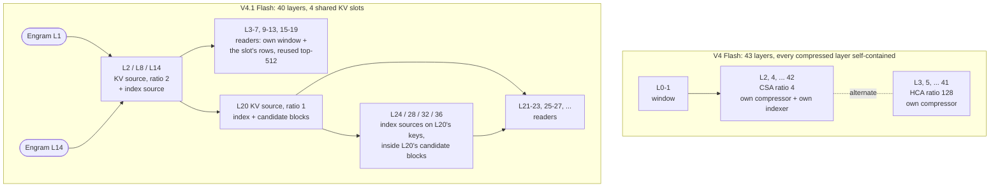

# DeepSeek V4.1 Flash (`deepseek41`): what differs from V4 Flash

This file lists only what DeepSeek-V4.1-Flash-1017 changes against DeepSeek V4 Flash as written in
[../deepseek4/SPEC.md](../deepseek4/SPEC.md) ("SPEC") and ported per [../deepseek4/PORT.md](../deepseek4/PORT.md). It
covers the text forward pass (no MTP / DSpark; images are in the last row of the table in section 8) and says, for each piece, where Abyss implements it.
Notation as in SPEC: `rms(v) = v/sqrt(mean(v^2)+eps)`, `RMS(v,w) = rms(v)*w`, `X` = the residual `[n_embd, 4 streams]`,
ggml shapes `{in, out}`.

References: antirez's DwarfStar (`ds4`, it wrote the converter of the ds4-layout GGUFs and decides their conventions)
and llama.cpp's V4.1 pull request (#28696, `src/models/deepseek41.cpp`). Where the two disagree Abyss follows ds4
(section 9).

## 0. The deltas at a glance

| Area | V4 Flash | V4.1 Flash (1017) | In Abyss |
| --- | --- | --- | --- |
| Shape | 43 layers, n_embd 4096, 256 experts, ff 2048, q_lora 1024 | **40 layers, n_embd 5120, 384 experts (top 6), ff 2304, q_lora 1280** | `Glm5Geometry::from_gguf_dsv41` (`src/core/glm_model.cu`) |
| RMS eps | 1e-6 | **1e-20** in every RMSNorm (hc_eps stays 1e-6) | geometry `norm_eps` |
| Compressed KV | every compressed layer owns a compressor: ratio 4 (CSA, overlapping) or 128 (HCA) | **4 KV-source layers (2, 8, 14, 20)** own four shared caches: ratio 2 (gated pairs, no APE, no overlap) or ratio 1 (a row a token). The other compressed layers read their source's rows | `publish_kernel` (`src/kernels/cuda/dsv41_fast.cu`); roles `kv_slot` / `kv_src` |
| Indexer | own indexer compressor on every CSA layer, 64 heads | **no indexer compressor**: index keys = `indexer.attn_k` @ the pooled latent (owned by the KV sources), **32 heads**. 8 index-source layers pick the top-512; the layers between them **reuse** that choice | roles `idx_src`; `fast_dsv41_attn` (`src/core/dsv41_fast_path.cu`) |
| Candidate blocks | - | layer 20 keeps the top 2,048 blocks of 8 rows; index sources 24-36 score only inside them. Active past 16,384 compressed rows | `block_max_kernel` .. `mask_kernel`; the shared top-k in `src/kernels/cuda/dsa_topk.cuh` (2,048 winners from v1.3.32) |
| q path | `q = rms(q_b @ qr)` per head | **no per-head q norm** | `q_rope_kernel` |
| Hyper-connections | a sublayer collapses with its own `pre` | **`pre` lags one sublayer**; layer 0 uses one-hot `[1,0,0,0]` | `HcArgs::pre_use` / `HcFinishArgs::pre_use` (`glm_fast.cu`, `glm_batch.cu`) |
| Head | `output_hc_fn/base/scale` | **no tensors**: collapse with the last FFN `pre` | `head_kernel` (`dsv41_fast.cu`) |
| Router | layers 0-2 hash-routed (`tid2eid`) | **no hash layers**: every layer `top6(p + exp_probs_b)`; router weight F32 or BF16 | `moe_route` with `hash_layers = 0` |
| Engram | - | **new**: layers 1 and 14 add hashed n-gram table rows into the 4 streams before the layer; two tables of ~101 GB | `V41Engram`, `EngPool`, `engram_kernel` (section 3) |
| Chat | V4 template, DSML `tool_calls` / `invoke` / `parameter` | DSML `" calls"` / `" invoke"` / `" parameter"` (leading space), `<｜System｜>` 128799; the ds4-layout GGUFs mark the chat tokens as normal | `tools/strata_tokenizer.py` `deepseek_special_types`, `serve/frontend.py` |



## 1. Hyperparameters and layer roles

### 1.1 GGUF keys (prefix `deepseek41.`)

The ds4-layout GGUFs carry the HF config names; llama.cpp's converter writes V4's loader keys instead (section 9).
`from_gguf_dsv41` reads both.

| key | value | V4 equivalent (`deepseek4.`) |
| --- | --- | --- |
| num_hidden_layers | 40 (the HF config has 3 MTP layers; the GGUFs keep the first 40) | block_count |
| hidden_size | 5120 | embedding_length |
| num_attention_heads / num_key_value_heads | 64 / 1 | attention.head_count(_kv) |
| head_dim / qk_rope_head_dim | 512 / 64 | attention.key_length / rope.dimension_count |
| q_lora_rank | **1280** | attention.q_lora_rank |
| o_lora_rank / o_groups | 1024 / 8 | attention.output_lora_rank / output_group_count |
| n_routed_experts / num_experts_per_tok / n_shared_experts | **384** / 6 / 1 | expert_count / used / shared |
| moe_intermediate_size | **2304** | expert_feed_forward_length |
| sliding_window | 128 | attention.sliding_window |
| index_n_heads / index_head_dim / index_topk | **32** / 128 / 512 | attention.indexer.* |
| candidate_source_layer_id / candidate_topk_blocks / candidate_block_size | 20 / 2048 / 8 | new |
| hc_mult / hc_sinkhorn_iters / hc_eps | 4 / 20 / 1e-6 | hyper_connection.* |
| rope_theta / compress_rope_theta | 10000 / 160000 | rope.freq_base / attention.compress_rope_freq_base |
| rope_scaling factor / beta_fast / beta_slow / original_max_position_embeddings | 16 / 32 / 1 / 65536 | rope.scaling.* |
| rms_norm_eps | **1e-20** | attention.layer_norm_rms_epsilon (1e-6) |
| swiglu_limit | 10.0 (routed and shared) | swiglu_clamp_exp / _shexp |
| routed_scaling_factor / norm_topk_prob | 1.5 / true | expert_weights_scale / norm |
| compress_ratios | `[0, 0, 2 x18 (layers 2-19), 1 x20 (layers 20-39)]` | attention.compress_ratios |
| kv_source_layer_ids | [2, 8, 14, 20] | new |
| index_source_layer_ids | [2, 8, 14, 20, 24, 28, 32, 36] | new |
| max_position_embeddings | 1048576 | |
| engram.* | section 3 | new |

There is **no** `hash_layer_count` (V4's default of 3 must not be assumed).

### 1.2 What the ratios mean

They are the number of tokens per compressed row, not an enum:

- **0** (layers 0, 1): sliding window only, RoPE base 10000 without YaRN (as V4's ratio 0).
- **2** (layers 2-19): one row per token pair `[2b, 2b+1]`, pooled by a per-channel softmax over two gate scores
  (5.3). Not V4's CSA: no overlapping window, no APE, a single 512-wide projection.
- **1** (layers 20-39): one row per token, no pooling and no gate tensor: `RMS(attn_compressor_kv @ x)`, roped.

Every ratio != 0 layer ropes q / kv with the compressed YaRN RoPE (base 160000), as V4 does.

### 1.3 Tensors per layer

Common to all 40 layers: `attn_norm, ffn_norm, attn_sinks, attn_q_a, attn_q_a_norm, attn_q_b, attn_kv,
attn_kv_a_norm, attn_output_a, attn_output_b, hc_{attn,ffn}_{fn,base,scale}, ffn_gate_inp, exp_probs_b.bias,
exp_probs_b_vl.bias, ffn_{gate,up,down}_{exps,shexp}`.

| layers | extra tensors | role |
| --- | --- | --- |
| 0 | - | window |
| 1 | engram_embd, engram_kv, engram_q_norm, engram_k_norm | window + Engram |
| 2, 8 | attn_compressor_kv, attn_compressor_gate, attn_compressor_norm, indexer.attn_k, indexer.k_norm, indexer.attn_q_b, indexer.proj | KV source (ratio 2), index-key owner, index source |
| 14 | the same + the four Engram tensors | KV source (ratio 2) + Engram |
| 20 | attn_compressor_kv, attn_compressor_norm, indexer.attn_k, indexer.k_norm, indexer.attn_q_b, indexer.proj (**no gate**) | KV source (ratio 1), index-key owner, index source, candidate source |
| 24, 28, 32, 36 | indexer.attn_q_b, indexer.proj | index source (reads layer 20's keys) |
| the rest of 3-39 | - | reader: own window, the slot's compressed rows, the last index source's top-512 |

Gone against V4: `output_hc_fn/base/scale`, `ffn_gate_tid2eid`, `attn_compressor_ape`, every `indexer_compressor_*`,
`indexer.proj` outside the index sources. `exp_probs_b_vl` is the bias for image tokens. The packer does not pack it as a tensor: when the GGUF has it, `tools/iq_pack.py` writes it as `exp_probs_b_vl.f32` (layers x experts, F32) next to the pack, and the engine reads that file (or the file named by `STRATA_GLM_VL_BIAS`). Image positions route with it; the text positions keep `exp_probs_b`.

The roles are not in the metadata of every GGUF: Abyss takes ds4's fixed lists (`kv_source = {2,8,14,20}`,
`index_source = kv_source ∪ {24,28,32,36}`, `engram = {1,14}`, cache slot `owner = il<8 ? 0 : il<14 ? 1 : il<20 ? 2 : 3`)
and checks them against which tensors are present when it binds the weights.

### 1.4 Who computes, who reads

Per token and layer:

1. **Raw window (every layer, readers too):** a 128-row ring of the layer's own `kv` (K = V, 512 wide, roped), as V4.
2. **Compressed rows (KV sources only):** source `s` writes `comp[s][row]` (512) and `index_k[s][row]` (128). Readers
   never run a compressor; they attend over `comp[owner]`. Index sources 24-36 score against `index_k[3]` (layer 20's).
   Slots 0-2 hold `ctx/2 + 1` rows, slot 3 `ctx + 1`.
3. **Top-k (index sources only):** an index source computes `sel[512]` over `comp[owner]`; the readers after it reuse
   that `sel` unchanged (3-7 use layer 2's, 9-13 layer 8's, 15-19 layer 14's, 21-23 layer 20's, 25-27 layer 24's, ...).
4. **Candidate mask (layer 20, used by 24 / 28 / 32 / 36):** section 2.

## 2. Candidate blocks

On an index-source layer with ratio 1 at position `p`, `n_comp = p + 1` and `s[j]` is the layer's indexer score (5.5,
`-inf` for `j >= n_comp`):

```
# layer 20, after its own scores (its own top-512 is NOT filtered):
B = ceil(n_comp / 8)
bs[c] = max_{j in [8c, min(8c+8, n_comp))} s[j]
bs[(n_comp-1)/8] = +inf                       # the newest block is always kept
top = min(2048, B)
mask[c] = 0 if c in top_k(bs, top) else -inf

# layers 24, 28, 32, 36, before their own top-512:
s[j] = (j < n_comp and mask[j/8] == 0) ? s[j] : -inf
```

With `B <= 2048` every block is kept, so the mask only acts past 16,384 compressed rows (a context over 16K tokens).
Abyss runs it with `block_max_kernel`, `block_select_kernel` (the exact top-k of `dsa_topk.cuh`), `keep_kernel` and
`mask_kernel`. Up to v1.3.31 the shared top-k held 1,024 winners: past 8K tokens the block choice came from corrupt
ranks, and past 16K it wrote out of range (the engine died on the 16,385th token). v1.3.32 holds 2,048.

## 3. Engram

### 3.1 Tensors and keys

| name | type | shape {in, out} | meaning |
| --- | --- | --- | --- |
| `blk.{1,14}.engram_embd.weight` | I8 raw rows (ds4 layout) or a ggml type (llama.cpp layout) | {264, ~384M rows} | row = 256 x FP8-E4M3 + 8 x E8M0 scales (one per 32) |
| `blk.{1,14}.engram_kv.weight` | F16 (Q2_K in some GGUFs) | {6144, 25600} | 6144 = 24 columns x 256; 25600 = (4 + 1) x 5120: a key per stream + one shared value |
| `blk.{1,14}.engram_q_norm.weight` | F32 | {5120, 4} | per-stream RMS weight on the residual side |
| `blk.{1,14}.engram_k_norm.weight` | F32 | {5120, 4} | per-stream RMS weight on the key side |

Keys: `engram.encoding = "e4m3_e8m0_32_row264"`, `engram.layer_ids = [1,14]`, `engram.rows`,
`engram.compressed_vocab_size = 99092`, `engram.pad_id = 2`, `engram.token_map` (u32 x 129280), `engram.primes`
(u32 x 48, `[layer 2][ngram 3][head 8]`), `engram.multipliers` (u64 x 8, `[layer 2][4]`). Fixed constants: max n-gram 4,
8 heads, 24 columns, head width 256, rows of 264 bytes. The row offsets are the running sum of the primes in
`[ngram][head]` order, from 0 for each table.

### 3.2 Hash (host side, per token)

`tail[3]` holds the mapped ids of the previous three tokens (newest first, DEAD = -1 at the start). It is conversation
state: Abyss keeps it per position (`V41Engram::hist`), so a rollback or a reused prefix needs nothing extra.

```
cur = token_map[tok]; ids[0] = cur; blocked = false
for j in 1..3: id = tail[j-1]; blocked |= (id == DEAD); ids[j] = blocked ? pad_id : id
for table e in {0 (layer 1), 1 (layer 14)}:
    h = ids[0] * M[e][0]; off = 0                       # uint64, wrapping
    for j in 1..3:                                      # n-gram sizes 2, 3, 4
        h ^= ids[j] * M[e][j]
        for k in 0..7:                                  # head
            col = (j-1)*8 + k
            row[e][col] = (h % P[e][col]) + off; off += P[e][col]
tail = [cur, tail[0], tail[1]]
```

24 rows per table, 48 a token (12,672 bytes). There is no 1-gram: column 0 is the bigram.

### 3.3 Row decode

```
c[0..255] = E4M3FN codes, s[0..7] = E8M0 exponents
e4m3(b): e = (b>>3)&15, m = b&7; v = e ? (8+m)*2^(e-10) : m*2^-9; sign = b&0x80
x[i] = bf16_round( e4m3(c[i]) * 2^(s[i/32] - 127) )
```

The 24 rows of a table give a 6144-vector `emb[col*256 + d]`. Tables in a ggml type (llama.cpp's converter, or a
Q2_K table) are decoded with ggml's `to_float` instead (the pack's `engram.txt` says which).

### 3.4 Mixing into the streams

Before layers 1 and 14, on the raw residual, before that layer's attention HC mix is computed:

```
kv    = engram_kv @ emb                                  # 25600
key_h = kv[h*5120 : (h+1)*5120]  (h = 0..3); val = kv[4*5120 : 5*5120]
for h in 0..3:
    s = dot( RMS(X[:,h], qn[h]), RMS(key_h, kn[h]) ) / sqrt(5120)       # eps 1e-20
    g = sigmoid( copysign(sqrt(max(|s|, 1e-6)), s) )
    X[:,h] += g * val
```

`engram_kv` stays in VRAM (629 MB a token for the two layers at F16); `engram_kernel` (`dsv41_fast.cu`) does the gate
and the add.

### 3.5 How Abyss reads the tables

The tables are never loaded or packed: the pack keeps their offsets (`engram.txt`, `engram_token_map.u32`) and the
engine reads rows from the GGUF with `pread` on its own descriptor (`POSIX_FADV_RANDOM`).

- A read pool (`EngPool`, 15 threads + the caller, `STRATA_DS41_ENGRAM_THREADS`) reads a token's 48 rows in parallel,
  and a prompt's rows in blocks of 256 tokens (`dsv41_engram_prompt`).
- A direct-mapped cache of raw rows (`STRATA_DS41_ENGRAM_CACHE_MB`, default 256 -> 132 MB / 524,288 rows). Short texts
  hit it ~2%; over a swe-bench session (1.6-1.8 M rows) about half the rows come from it. Logits are bit-identical with
  and without it.
- `STRATA_GLM_TIMING=1` prints `deepseek41 Engram CUDA0: <rows>, <cache %>, <read>` per answer.

## 4. Router

```
logits = ffn_gate_inp @ x                 # F32 or BF16 weight {5120, 384}
p   = sqrt(softplus(logits))
sel = top6(p + exp_probs_b)               # every layer; no tid2eid
w   = p[sel] / max(sum p[sel], 6.1035e-5) * 1.5
expert(x) = down( silu(min(g,10)) * clamp(u,-10,10) )        # gate/up {5120, 2304}, down {2304, 5120}
f = sum_k w_k expert_k(x) + shared(x)
```

Same scoring, normalization and scale as V4; only the hash layers are gone and the shapes grow.

## 5. Attention

### 5.1 Projections

```
qr = RMS(attn_q_a @ x, attn_q_a_norm)          # {5120, 1280}
q  = reshape(attn_q_b @ qr, [512, 64])         # no per-head rms (V4 had one)
q  = rope(q, p) on dims [448, 512)
kv = RMS(attn_kv @ x, attn_kv_a_norm); kv = rope(kv, p) on [448, 512)
```

RoPE / YaRN as SPEC 3.5 (adjacent pairs on the last 64 dims).

### 5.2 Keys attended

For position `p` on layer `il` (ratio `r`, slot `owner`, `n_comp = r ? (p+1)/r : 0`):

```
raw  = the layer's own window rows max(0, p-127) .. p
comp = r == 0: none;  n_comp <= 512: comp[owner][0 .. n_comp-1];  else comp[owner][sel]   (|sel| = 512)
o = softmax_with_sinks( q . [raw ; comp] / sqrt(512) ) @ [raw ; comp];  de-rope [448, 512)
```

On ratio-1 layers the token's own row is published before attention (`n_comp = p + 1`); on ratio-2 layers pair `b` is
visible from `p = 2b + 1`, and the open token is covered by the window only.

### 5.3 Compressor (KV sources only)

```
v = attn_compressor_kv @ x                                    # {5120, 512}
ratio 2 (layers 2, 8, 14):
    g = attn_compressor_gate @ x                              # no APE
    p even: keep (v, g) as the pending half; no row
    p odd:  c[d] = (v0[d] e^{g0[d]-m} + v[d] e^{g[d]-m}) / (e^{g0[d]-m} + e^{g[d]-m}),  m = max(g0[d], g[d])
            row b = p/2, rope position 2b
ratio 1 (layer 20): c = v, row p, rope position p
on a finished row:
    c  = RMS(c, attn_compressor_norm)
    ik = rope(RMS(indexer.attn_k @ c, indexer.k_norm), pos) on [64, 128)   # from the UNROTATED latent
    comp[owner][row] = rope(c, pos) on [448, 512);  index_k[owner][row] = ik
```

`publish_kernel` does this for a token. The pending ratio-2 half (2 x 512 floats per source) is the only state a
later position overwrites besides the window rings, so the conversation snapshot (`dsv4_snap_copy`) saves those two
and nothing else.

### 5.4 Output

As V4 with a wider out dimension: 8 groups of 8 heads, `attn_output_a` {4096, 8192} as {4096, 1024, 8}, then
`attn_output_b` {8192, 5120}. Sinks as V4.

### 5.5 Lightning indexer (index sources)

```
iq = rope(reshape(indexer.attn_q_b @ qr, [128, 32]), p) on [64, 128)
w  = indexer.proj @ x                                          # {5120, 32}
score[j] = (1/64) * sum_{h<32} relu(iq_h . K[j]) * w_h         # 1/64 = 1/sqrt(128*32); V4: 1/sqrt(128*64)
K = index_k[owner] (layer 20's for 24-36)
(il > 20: the candidate mask, section 2)
sel = top_k(score, min(512, n_comp))
```

On layers 20-36 there is one key per token, not one per 4 tokens as in V4's CSA: at 128K that is 131K keys x 32
heads on five index sources.

### 5.6 Reference rounding (not done)

ds4 emulates the released BF16 / FP8 / FP4 graph (BF16 after most matmuls, an FP8 window, FP4 compressed latents and
index keys). Abyss, like llama.cpp, keeps FP16 caches and FP32 math. Against the unquantized 1017's top-256 this costs
no visible KL on the GGUFs used here (the quantization dominates).

## 6. Hyper-connections and head

The mix itself is V4's (`m = fn^T @ rms(flat)`, `fn` {20480, 24}, pre / post / Sinkhorn comb); the `rms(flat)` eps is
1e-20. What changes is which `pre` collapses a sublayer's input:

```
X = repeat(embed(tok), 4); pre_prev = [1, 0, 0, 0]
for il in 0..39:
    if il in {1, 14}: X = engram(X)
    (preA, postA, combA) = mixes(X, hc_attn_*)
    a = Attn(RMS(sum_h pre_prev[h] X[:,h], attn_norm))          # the PREVIOUS sublayer's pre
    X = postA[d]*a + sum_s combA[d,s] X[:,s]
    (preF, postF, combF) = mixes(X, hc_ffn_*)
    f = MoE(RMS(sum_h preA[h] X[:,h], ffn_norm)) + Shared(...)  # the attention sublayer's pre
    X = postF[d]*f + sum_s combF[d,s] X[:,s]
    pre_prev = preF
logits = output @ RMS(sum_h pre_prev[h] X[:,h], output_norm)    # no output_hc_* tensors
```

Abyss passes the lagged weights as `pre_use` to the HC kernels of the token path and the prompt path, and the head
collapses with the last FFN `pre` (`head_kernel`).

## 7. Tokenizer and chat

- Same BPE as V4-0731 (`joyai-llm` pre-tokenizer, vocab 129280, identical merges). Nine ids differ, among them
  **128799 `<｜System｜>`** and the image token 129264. The chat ids are V4's: `<｜User｜>` 128803, `<｜Assistant｜>`
  128804, `<think>` 128821, `</think>` 128822, `｜DSML｜` 128825.
- **The ds4-layout GGUFs mark only bos / eos / pad as control tokens** and carry no chat template. Read as they are,
  the server splits `<｜User｜>` into characters and the model writes its end markers as text. From v1.3.30 the
  tokenizer restores V4's types (control for `<｜...｜>` and `<|EOT|>`, user-defined for `<think>`, `</think>`,
  `｜DSML｜`, `<dsml:`, `</dsml:`) on GGUF read and on pack load. Teacher-forced KL does not see this: smoke-test a new
  GGUF through the chat API.
- DSML tags gain a leading space: `<｜DSML｜ calls>`, `<｜DSML｜ invoke name="...">`, `<｜DSML｜ parameter name="..."
  string="true|false">`. Copy the 1017 chat template into the pack (`tokenizer/chat_template.jinja`) when the GGUF has
  none.
- A reasoning ends only at the special `</think>` token (v1.3.29): V4.1 writes the tag as text when it explains a chat
  template.

## 8. What Abyss runs and what it does not (v1.3.32)

| Piece | State |
| --- | --- |
| Token path (decode) | done; same GGUF as llama.cpp's PR: teacher KL 0.639 against its 0.636 |
| Prompt path | batched MoE, the Engram rows per 256-token block; the attention a token at a time (~5 ms a token) |
| Conversation reuse | done (window rings + pending pair halves); file slots: no |
| Candidate blocks past 16K | done (fixed in v1.3.32: 24,005 tokens through the decode path) |
| Speculative decoding / verify window | not yet (the 1017 FP8 release has MTP layers; the GGUFs do not) |
| Layer split | not yet |
| Images | partly: the image encoder is llama.cpp's `strata-vision` (b11870 or later, projector `deepseek41v`), run on the CPU; image positions take the encoder's vectors, route with `exp_probs_b_vl` and skip the Engram. Tried on one GPU with one 4-file GGUF (three pictures); not tried: the GPU encoder lending expert memory, large or several pictures, GGUFs of the newer 6-file layout, HIP. Setup does not install it (the `vision` entry is written by hand) |

## 9. Where ds4 and llama.cpp disagree

1. **Reader layers.** ds4 reuses the last index source's top-512; llama.cpp's PR builds a top-k only on index sources
   and lets readers attend over every visible compressed row (its own comment says they reuse the choice). It only
   shows past 512 compressed rows, so compare against llama.cpp below 512 tokens. Abyss follows ds4.
2. **Candidate mask.** llama.cpp skips it (it notes a 16K cap). Abyss implements it.
3. **Engram gate at `s == 0`.** llama.cpp's `sgn` gives 0.5, ds4 and the reference `copysign` 0.50025. Abyss uses
   copysign.
4. **Key and tensor names.**

| concept | ds4-layout GGUF | llama.cpp `deepseek41` |
| --- | --- | --- |
| hidden size / eps / ratios | `hidden_size`, `rms_norm_eps`, `compress_ratios` | `embedding_length`, `attention.layer_norm_rms_epsilon`, `attention.compress_ratios` |
| source layers | `kv_source_layer_ids`, `index_source_layer_ids` | not stored; from the tensors present |
| Engram keys | `engram.{encoding, layer_ids, rows, compressed_vocab_size, pad_id, token_map (u32), primes (u32), multipliers (u64)}` | `engram.{head_count, key_length, max_ngram_size, layer_ids, multipliers, primes (u64), offsets (u64), token_map (i32), pad_id}` |
| Engram table | `engram_embd` I8 {264, rows} | `engram_embd` {256, rows} in a ggml type |
| Engram projection / norms | `engram_kv`, `engram_q_norm`, `engram_k_norm` | `engram_wkv`, `engram_q`, `engram_k` |
| everything else | V4's names (`attn_*`, `indexer.*`, `hc_*`, `ffn_*`) | the same |

## 10. Validation

- Same GGUF (mrfakename Q2_K, llama.cpp layout) against llama.cpp's PR, seq 0 of Lucebox's held-out set, 1,023
  positions: nll 2.653 / 2.661, top-1 46.5 / 46.8%, teacher KL 0.639 / 0.636. Logits against each other: KL 0.045,
  same top token 93.2% (all-Q2_K dense weights; V4's Q8_0 dense gave 0.006). Position 0 alone is chaotic (llama.cpp's
  own CPU and batch paths differ at KL 3.95 there), so short prompts mislead.
- Prompt path against the token path (255 tokens prefilled, 256 scored): KL 0.013, argmax 93%.
- Snapshot reuse (1,042-token question, answer, follow-up; the snapshot at an odd position, through the pending
  pair): both turns word for word the same with and without reuse.
- Every release re-checks DeepSeek V4 (KL 0.0059 against llama.cpp) and GLM-5.3-Flash (0.000000) on the shared code.
